# Character Ocean

一片由字符组成的海洋，一个可以放慢节奏的页面。

A quiet, character-rendered ocean with translucent search, music and focus interfaces.

基于 Canvas 2D 与 TypeScript 的前端视觉演示：鱼群在背景中游动，中央保留轻盈的半透明横栏。支持三种界面、七种字符表现、深浅主题，并可打包为一个离线 HTML 文件。

[在线体验](https://shark-ascii-ocean-1022.blond-hippo-0375.chatgpt.site/) · [高清动图](#高清动图演示) · [下载源码](https://github.com/jiezi1234/character-ocean/archive/refs/heads/main.zip) · [授权说明](LICENSE.md)

> 动画核心参考并改编自 [stackedlol/ascii-sharks](https://github.com/stackedlol/ascii-sharks)，作者为 [stackedlol](https://github.com/stackedlol)。本仓库独立维护，具体来源和改编范围见下方“参考项目与致谢”。上游目前未声明开源许可证，因此不能将整个项目视为 MIT 授权；新增界面及构建工具的 MIT 授权范围见 [LICENSE.md](LICENSE.md)。

## 特性

- **三种中央界面**：搜索、播放、专注。右下角一键循环切换，记住上次选择。
- **七种字符风格**：ASCII、纯字符、盲文点阵、方块阴影、几何符号、线条编织、汉字艺术。
- **十一种大鱼**：蝠鲼、鲸鲨、翻车鱼、灰鲨、锤头鲨、大锤头鲨、虎鲨、斑马鲨、长尾鲨、灰鲭鲨、护士鲨。
- **鱼群与涟漪**：背景鱼群运动、鼠标交互、水面扰动，以及可调整的游动速度。
- **深浅主题**：浅色留白与深蓝夜间配色，半透明磨砂横栏、细边框与轻字体。
- **响应式布局**：适配桌面与手机，支持键盘操作及系统“减少动态效果”设置。
- **无需运行时依赖**：原生 TypeScript + Canvas 2D；字体、样式与脚本全部内嵌，构建后的页面可离线打开。

## 高清动图演示

七种字符风格均为真实页面录制：**1600 × 900 原生分辨率、约 12 帧/秒、6 秒循环**。以下分别搭配搜索、播放和专注布局，点击动图可查看原尺寸。浅色主题下的轻字符与半透明横栏保持页面原貌。

[ASCII](#ascii-原始字符) · [TYPE](#type-纯字符) · [DOTS](#dots-盲文点阵) · [BLOCK](#block-方块阴影) · [GEO](#geo-几何符号) · [LINES](#lines-线条编织) · [HANZI](#hanzi-汉字艺术)

### ASCII 原始字符

搜索布局。等宽字符叠加小格明暗，保留最初的字符海洋质感。

[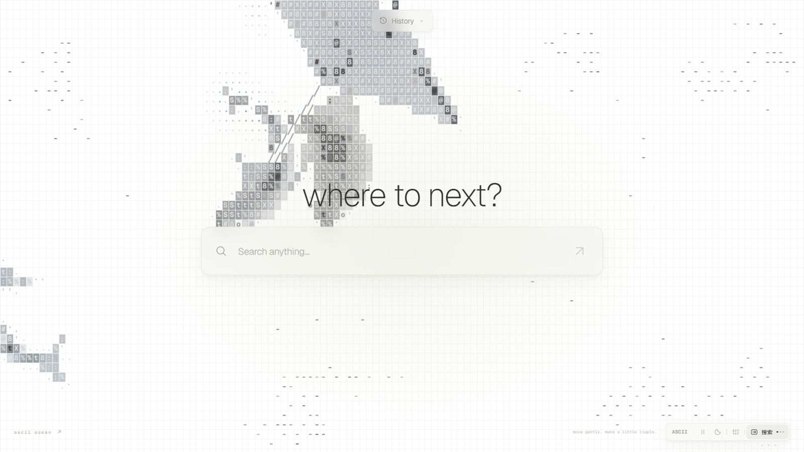](docs/demos/ascii.gif)

### TYPE 纯字符

播放布局。用 `@ # % R E A T` 与标点的疏密勾勒鱼身、光影和皮肤纹理。

[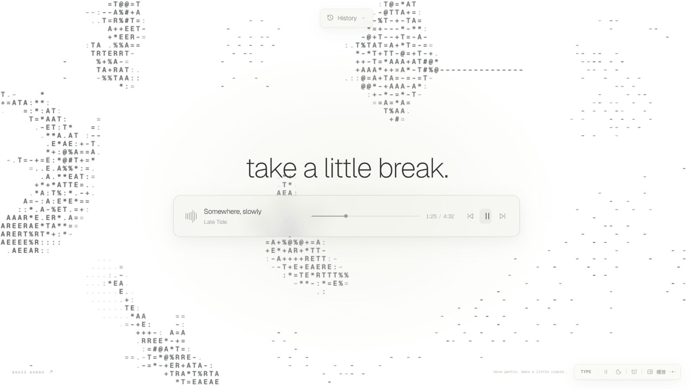](docs/demos/type.gif)

### DOTS 盲文点阵

专注布局。细密的盲文点阵构成轻盈、通透的轮廓。

[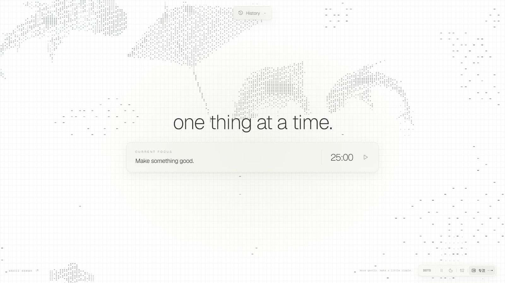](docs/demos/braille.gif)

### BLOCK 方块阴影

搜索布局。通过方块与阴影表达明暗，呈现更厚实的像素质感。

[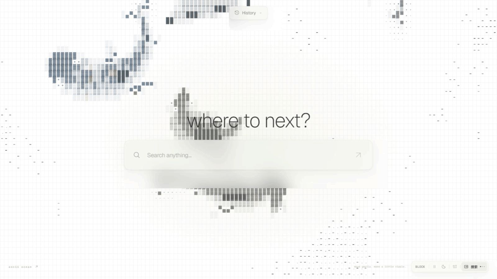](docs/demos/blocks.gif)

### GEO 几何符号

播放布局。圆点、圆环、菱形与方块组成游动的几何鱼群。

[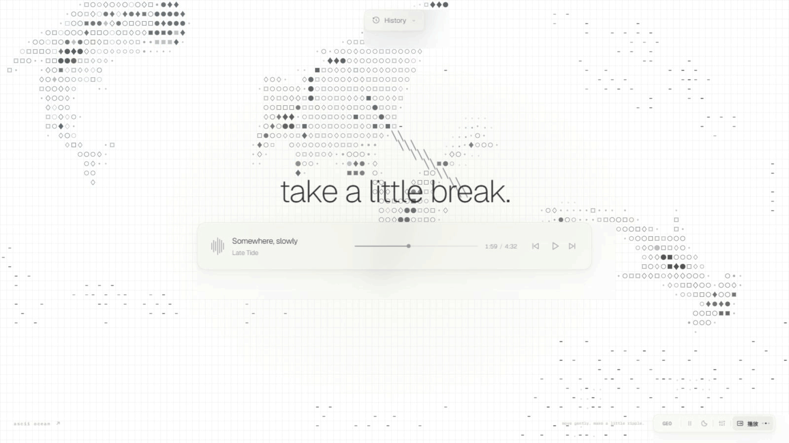](docs/demos/geometry.gif)

### LINES 线条编织

专注布局。线条随鱼身方向排列，像在水中舒展的编织线稿。

[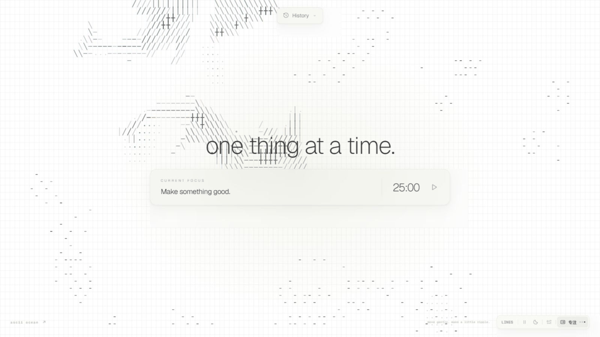](docs/demos/lines.gif)

### HANZI 汉字艺术

搜索布局。用“一、十、川、水、魚、鯊”的笔画密度塑造轮廓与层次。

[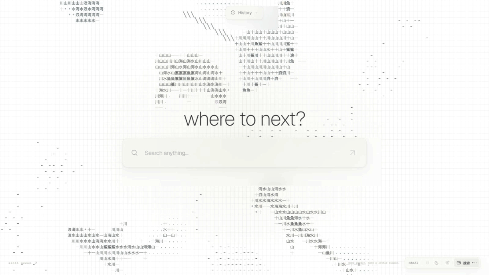](docs/demos/hanzi.gif)

## 三种界面

| 搜索 | 播放 | 专注 |
| --- | --- | --- |
| 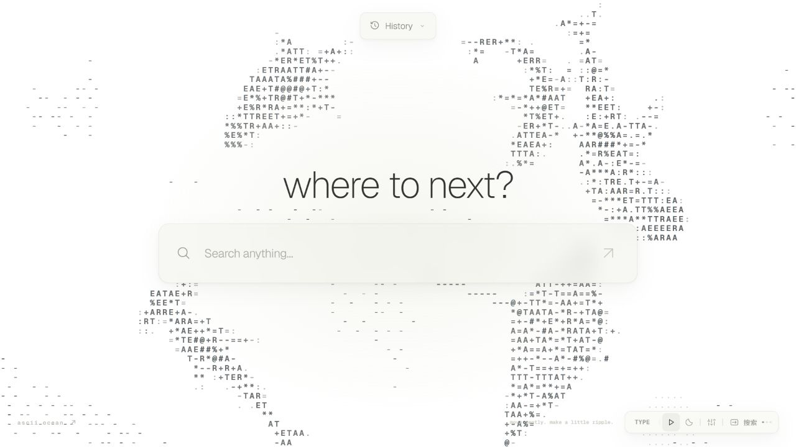 | 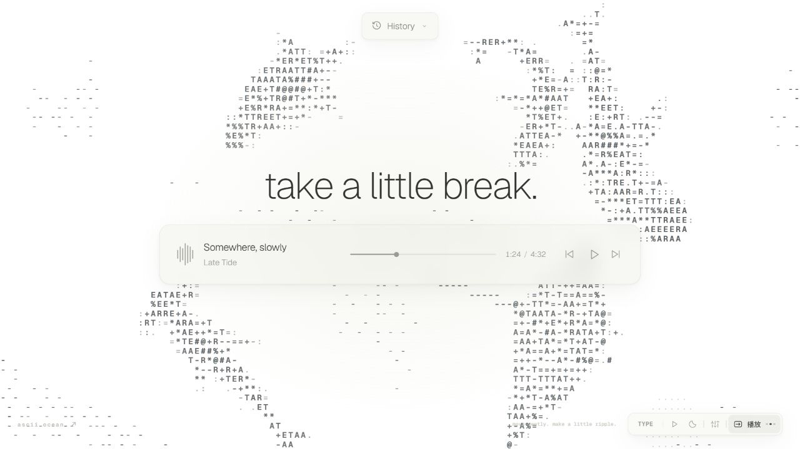 | 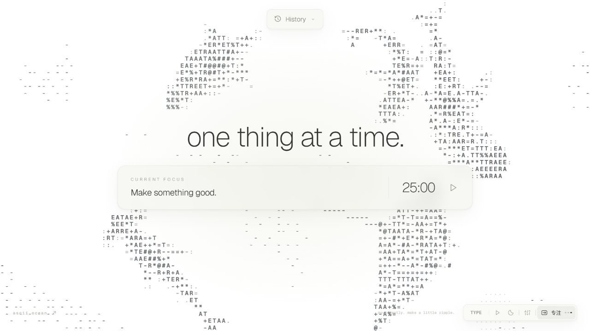 |
| 单行输入与本地 History | 曲目信息、进度、播放控制 | 可编辑任务与 25 分钟计时 |

这是一个以视觉展示为主的前端项目，没有连接搜索、AI 或音乐服务。

- **搜索**：输入后按 Enter 或点击箭头，将文字保存到本地 History；不会发起网络搜索。
- **播放**：三首虚拟曲目，支持切换、进度拖动、播放/暂停和波形动画；没有音频输出。
- **专注**：任务文字可编辑；点击播放开始 25 分钟倒计时，支持暂停/继续，点击时间重置。
- 切换到其他界面时，当前播放演示或专注计时自动暂停。刷新后专注计时回到 25 分钟。

## 深色模式

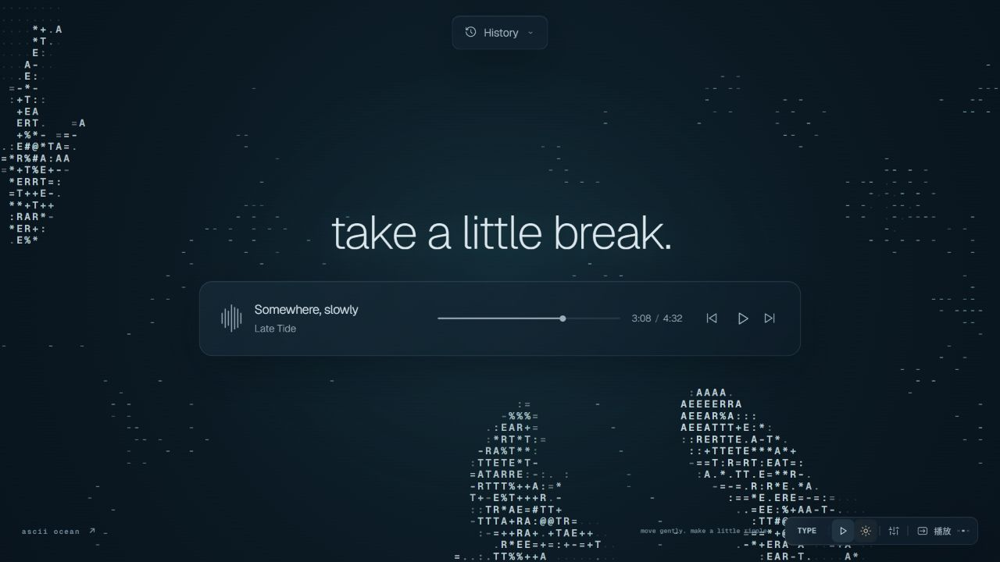

点击右下角月亮/太阳按钮切换主题。字符鱼群、横栏、弹出面板及控件会一并切换配色。

## 快速开始

### 直接打开

下载并解压本仓库，双击 `dist/index.html` 即可运行，不需要安装依赖，也不需要联网。

不要直接打开 `src/index.html`：它是构建模板，脚本、样式和字体会在构建时注入。

### 本地开发

需要 Node.js 22 或更高版本，以及 npm。

```bash
git clone https://github.com/jiezi1234/character-ocean.git
cd character-ocean
npm ci
npm run check
npm run build
npm run dev
```

然后打开 <http://127.0.0.1:4173>。

| 命令 | 作用 |
| --- | --- |
| `npm ci` | 根据锁文件安装构建依赖 |
| `npm run check` | TypeScript 类型检查 |
| `npm run build` | 生成独立的 `dist/index.html` |
| `npm run dev` | 在本机预览已构建的文件 |

预览服务器没有热更新。修改源码后重新执行 `npm run build`，再刷新页面。

## 操作说明

| 位置 | 操作 |
| --- | --- |
| 右下角“搜索 / 播放 / 专注” | 循环切换中央界面，三个圆点表示当前样式 |
| 右下角 ASCII / TYPE 等按钮 | 循环切换字符风格 |
| 右下角播放/暂停图标 | 控制背景海洋动画，与中央播放栏独立 |
| 右下角月亮/太阳 | 切换深浅主题 |
| 右下角设置按钮 | 选择鱼种、字符风格、速度；添加鱼或触发涟漪 |
| 顶部 History | 查看并重新填入此前保存的文字 |
| 中央专注时间 | 重置为 25:00 |
| 空白水面 | 点击产生涟漪 |

混合鱼群初始包含五种大鱼，可添加至九条。

### 字符风格

| 名称 | 表现 |
| --- | --- |
| ASCII | 原始字符与小格明暗 |
| TYPE | 使用 `@ # % R E A T` 与标点，以字符疏密塑造光影 |
| DOTS | 盲文点阵，轻盈通透 |
| BLOCK | 方块与阴影，像素感更强 |
| GEO | 圆点、圆环、菱形与方块 |
| LINES | 沿鱼身排列的线条 |
| HANZI | 用“一、十、川、水、魚、鯊”的笔画密度表达层次 |

## 本地数据

History（最多 30 条）、主题、字符风格、中央界面选择和专注任务文字保存在浏览器的 `localStorage` 中。项目没有应用后端、账号系统、统计埋点或云端同步；上述内容不会由页面代码上传。

在线网址、本地预览服务器与直接打开的 HTML 使用各自的浏览器存储，不会共享记录。清除对应站点的浏览器数据即可重置偏好与 History。

## 项目结构

```text
src/
  app.ts         界面状态、主题、播放演示、计时与本地存储
  index.html     页面结构模板
  style.css      主题、半透明材质与响应式布局
  engine.ts      动画循环与 Canvas 生命周期
  world.ts       鱼群运动与交互
  renderer.ts    七种字符风格与绘制
  species.ts     鱼种参数
  math.ts        数学工具
assets/          内嵌字体与原始字体授权文件
docs/images/     界面截图
docs/demos/      七种字符风格的高清 GIF 动图
licenses/        新增前端代码的 MIT 许可
build.mjs        esbuild 打包、字体与样式内嵌
serve.mjs        本地预览服务器
dist/index.html  可直接打开或部署的独立页面
```

修改界面文案与交互可从 `src/index.html` 和 `src/app.ts` 入手；颜色、留白与横栏样式在 `src/style.css`；鱼群绘制在 `src/renderer.ts`。

## 部署

执行 `npm run build` 后，将 `dist/` 作为静态目录部署即可。页面没有运行时服务器依赖、不要求环境变量，也不依赖当前演示所使用的托管平台。

仓库中不包含演示站点的托管身份、部署凭据或本机配置。重新部署不会自动获得演示站点的管理权限。

## 参考项目与致谢

本项目的鱼群与鲨鱼动画基于 **[stackedlol/ascii-sharks](https://github.com/stackedlol/ascii-sharks)** 改编，感谢原作者 **[stackedlol](https://github.com/stackedlol)** 提供的字符海洋动画实现。

- **原项目**：https://github.com/stackedlol/ascii-sharks
- **参考版本**：[c521e24](https://github.com/stackedlol/ascii-sharks/commit/c521e24a787e6d4cc460d4cf2b9815f25e4fe453)
- **沿用并修改的代码**：`src/engine.ts`、`src/world.ts`、`src/renderer.ts`、`src/species.ts`、`src/math.ts`，涉及动画循环、鱼群运动、字符绘制和数学工具。
- **本项目的扩展**：三种半透明中央界面、七种字符风格、额外鱼种与蝠鲼轮廓、深浅主题、交互控制、本地记录和离线单文件构建。

这些动画模块包含原项目代码，并非仅借鉴视觉灵感。本仓库使用独立的 Git 历史；原作者归属与来源注释保留在源码、本 README 和 THIRD_PARTY_NOTICES.md 中。页面左下角链接指向维护者 [jiezi1234 的 GitHub 主页](https://github.com/jiezi1234)。

## 授权说明

- 动画核心：[stackedlol/ascii-sharks](https://github.com/stackedlol/ascii-sharks)。本项目在其基础上增加了鱼种、字符风格、主题与界面，保留上游作者归属。
- 新增界面与构建工具：按 [LICENSE.md](LICENSE.md) 所列文件范围使用 MIT 许可。
- Geist / Geist Mono 与 Noto Sans SC 字体：SIL Open Font License 1.1，原始许可保存在 `assets/`。
- 更详细的来源、上游版本与授权边界见 [THIRD_PARTY_NOTICES.md](THIRD_PARTY_NOTICES.md)。

欢迎通过 Issues 提出视觉改进建议。提交修改前，请执行 `npm run check` 和 `npm run build`，并将更新后的 `dist/index.html` 一并提交。
